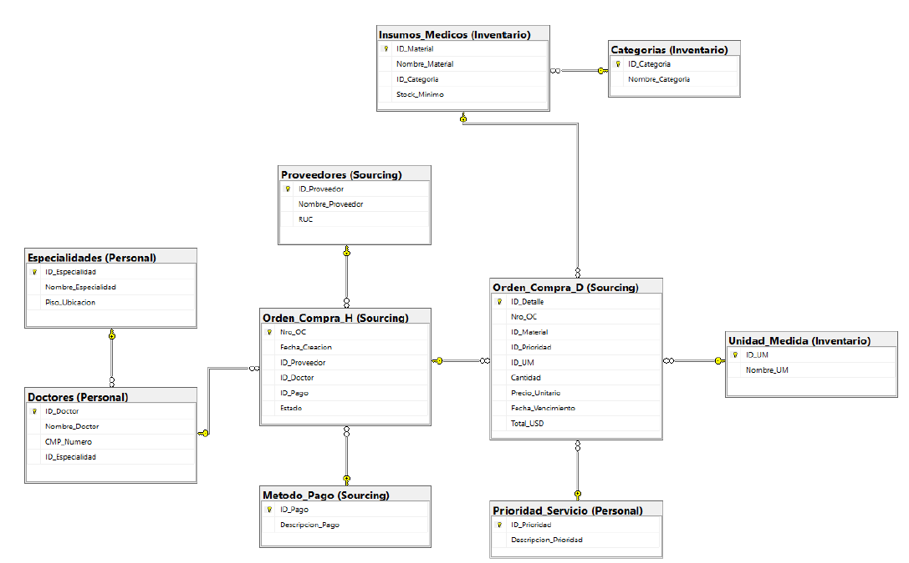

# 🏥 Base de datos relacional para una clínica: compras de insumos médicos (SQL Server)

**En una línea:** modelamos en SQL Server la cadena de compras de insumos de una clínica (personal médico, inventario y proveedores) y escribimos 15 consultas T-SQL para responder preguntas de gasto, dependencia de proveedores y eficiencia de compra.

**Stack:** Microsoft SQL Server (T-SQL) · Bizagi Modeler (DER) · SSMS

> ⚠️ **Datos ficticios:** los registros son datos de ejemplo creados para este proyecto del curso SQL Server for Analytics (WE Educación Ejecutiva). Los nombres de laboratorios y proveedores se usan solo como ilustración; no son operaciones reales. 

> 👥 **Proyecto grupal (Grupo 2)** desarrollado en el curso **SQL Server for Analytics** (WE Educación Ejecutiva).

## 🎯 Problema
Una clínica compra insumos a decenas de proveedores, para distintos servicios y con distintas formas de pago. Sin un modelo ordenado, preguntas básicas son difíciles de contestar: ¿cuánto se gasta en urgencias?, ¿de qué proveedores dependemos?, ¿cuánto de lo comprado está pagado o pendiente?

## 🧱 Qué construí

| Esquema | Tablas | Contenido |
|---|---|---|
| `Personal` | Especialidades, Doctores, Prioridad_Servicio | 30 especialidades, 200 doctores, 5 tipos de atención |
| `Inventario` | Categorias, Unidad_Medida, Insumos_Medicos | 20 categorías, 10 unidades de medida, 500 insumos |
| `Sourcing` | Proveedores, Metodo_Pago, Orden_Compra_H (cabecera), Orden_Compra_D (detalle) | 60 proveedores, 5 métodos de pago, 600 órdenes de compra, 200 líneas de detalle |

**10 tablas en 3 esquemas, ~1,630 registros**, con llaves primarias y foráneas en todas las relaciones y una columna calculada (`Total_USD = Cantidad × Precio_Unitario`) en el detalle de compra.

[](Media/DER.png)
*Haz clic en el diagrama para verlo en tamaño completo.*

## 🔎 Resultados de las consultas

| Pregunta | Resultado |
|---|---|
| **Gasto total** (200 líneas de compra) | **US$ 370,387** · promedio de US$ 1,852 por línea |
| **¿En qué se gasta?** (por tipo de atención) | Urgencias **27.6%**, consulta externa 24.6%, reserva de almacén 22.7%, cirugía 14.0%, hospitalización 11.2% |
| **¿De quién dependemos?** | Pfizer **17.4%** del gasto (riesgo medio) y Roche 14.6%: entre los dos, **32%**. Solo 29 de 60 proveedores tienen compras |
| **¿Cómo se paga?** | Crédito comercial a 30 días **33.2%**, transferencia 27.9%, tarjeta 14.0%, efectivo 13.1%, cheque 11.8% |
| **¿Qué se compra más?** | Reactivos de laboratorio (24.5%) y materiales de odontología (23.9%); 5 de 6 categorías con compras suman el 87.7% (clase A) |
| **Estado de las órdenes** (600 OC) | **80%** pagadas, **14%** pendientes, **6%** canceladas |
| **Picos de gasto** | Diciembre 2024 (US$ 69.4 mil) y abril 2025 (US$ 64.6 mil) |

## 🛠️ Técnicas de T-SQL usadas
`INNER JOIN` y `LEFT JOIN` entre hasta 4 tablas · `GROUP BY` / `HAVING` · `CASE` para segmentar · **funciones de ventana** (`SUM() OVER`) para porcentajes y acumulados · **CTE** para el análisis ABC · **`PIVOT`** · subconsultas · funciones de fecha (`DATEDIFF`, `DATENAME`) · `DECLARE` de variables.

## ⚠️ Limitaciones
- **Datos ficticios y acotados:** 400 de las 600 cabeceras de orden no tienen líneas de detalle. Las consultas de gasto usan las 200 órdenes con detalle (OC20240301 a OC20240500); la de estados usa las 600 cabeceras.
- **Pocos médicos con pedidos:** solo 10 de los 200 doctores aparecen como solicitantes, por lo que el análisis por especialidad y por doctor es ilustrativo.
- **Sin control de stock:** el modelo guarda un `Stock_Minimo` por insumo, pero no tiene tabla de existencias ni de recepciones, así que no calcula alertas de desabastecimiento.
- Las cantidades suman unidades, cajas, frascos y paquetes juntos, por lo que sirven como volumen de pedido y no como unidades físicas comparables.
- No se definieron índices; con este volumen no hace falta, pero un sistema real los necesitaría.

## 🚀 Cómo ejecutarlo
1. Abre **SQL Server Management Studio** (o Azure Data Studio) conectado a una instancia de SQL Server.
2. Ejecuta `Scripts/clinica_san_pablo.sql` de principio a fin: crea la base `DB_CLINICA_SAN_PABLO`, los esquemas y las tablas, carga los datos y corre las 15 consultas de análisis.

> Si la base ya existe, elimínala antes de volver a ejecutar el script; de lo contrario los datos se duplican.

## 📁 Estructura
```
├── Scripts/
│   └── clinica_san_pablo.sql        # DDL + carga de datos + 15 consultas T-SQL
├── Documentacion/                   # Material de apoyo del proyecto
├── GRUPO #2 - INFORME FINAL.pdf     # Informe técnico con diagramas y análisis de negocio
├── Media/
│   └── DER.png                      # Diagrama Entidad-Relación
└── README.md
```

## 👤 Autor
**Héctor Estéfano Gómez Vigo** · Estudiante de Estadística e Informática (UNALM)
[LinkedIn](https://www.linkedin.com/in/h%C3%A9ctor-est%C3%A9fano-g%C3%B3mez-9b6079289/) · 20230397@lamolina.edu.pe
